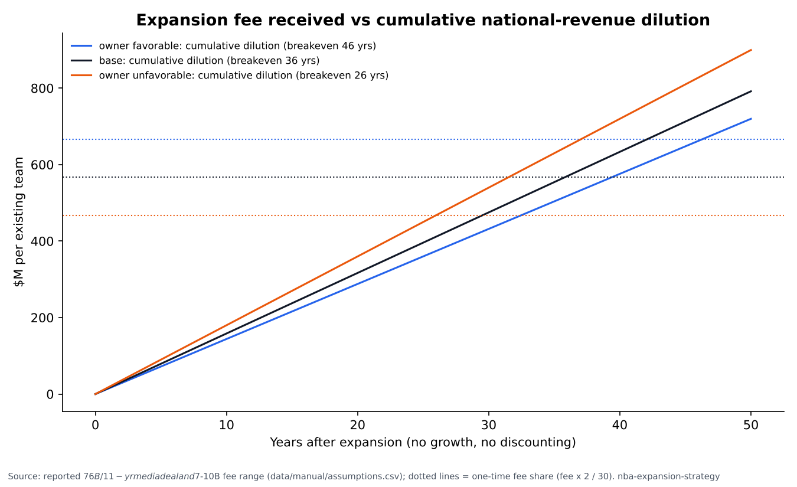

# Beyond Seattle and Vegas: NBA Expansion Market Strategy

## At a glance

- **Question:** Which North American markets are most attractive for an NBA team, which are overlooked, and does expansion pay off for existing owners?
- **Data scope:** 56 U.S. metro areas (CBSAs), public data only; Canada is out of scope.
- **Key numbers:**
  - Seattle ranks **#3** and Las Vegas **#7** among 29 non-NBA metros.
  - **3** non-NBA metros score at or above the median current NBA market (0.30).
  - Reported fee share per existing owner (base): **$566.7M**, compared with annual national-revenue dilution of **$15.8M**.
  - Base-case breakeven: **36 years** of dilution to equal the fee share (no growth, no discounting).


## Approach

The scorecard has four pillars. Every factor is converted to a z-score across the 56 metros; population, GDP and large-establishment counts are logged first. Factors are averaged with equal weights inside each pillar, and the four pillars are averaged with equal weights into a total score. Current NBA metros are scored the same way and serve as the benchmark.

1. **A. Market size and wealth:** population, median household income, share of residents aged 18-44, population growth 2020-25, and GDP.
2. **B. Basketball demand:** NCAA D-I men's home attendance per 1,000 residents, WNBA presence, and G League presence.
3. **C. Corporate money:** establishments with 500+ employees, as a total and per 100k residents.
4. **D. Competition and infrastructure:** NFL, MLB and NHL teams (counted as a negative), and whether the metro has an NBA-capable arena (17,000+ seats).

## Data & sources

| Factor | Source | Year |
|---|---|---|
| Population, households, income, age 18-44 | Census ACS 5-year summary file (www2.census.gov) | 2020-2024 |
| Population growth | Census Population Estimates, Vintage 2025 | 2020-2025 |
| GDP | BEA CAGDP1 county GDP summed to CBSA | 2024 |
| Large establishments (500+ employees) | Census County Business Patterns (metro file) | 2023 |
| NCAA D-I men's basketball home attendance | NCAA attendance records PDF | 2025-26 |
| NBA/NFL/MLB/NHL/MLS/WNBA/G League teams | Wikipedia league articles (current teams tables) | accessed 2026-11-05 |
| Arenas 17,000+ seats | Wikipedia: List of indoor arenas in the United States | accessed 2026-11-05 |
| Metro definitions | Census CBSA delineation files | July 2023 |
| Google Trends; NTTO overseas visitors | Skipped (see DEVIATIONS.md) | - |

**Coverage** (share of metros with data, from `outputs/coverage.csv`):

| factor | share_with_data | n_metros |
|---|---|---|
| population | 100% | 56 |
| median_hh_income | 100% | 56 |
| share_18_44 | 100% | 56 |
| households | 100% | 56 |
| pop_growth_2020_2025 | 100% | 56 |
| gdp_2024_usd | 98% | 56 |
| ncaa_d1_home_attendance | 100% | 56 |
| has_wnba | 100% | 56 |
| has_g_league | 100% | 56 |
| large_establishments_500plus | 100% | 56 |
| big4_other_leagues | 100% | 56 |
| arena_capable | 100% | 56 |
| google_trends_nba | 0% | 56 |
| overseas_visitors_ntto | 0% | 56 |

## Results

**Top 15 non-NBA metros** (equal weights; `outputs/rankings.csv`):

| rank_candidates | short_name | total_score | A_size_wealth | B_basketball_demand | C_corporate | D_competition_infra | overlooked | top_pillar |
|---|---|---|---|---|---|---|---|---|
| 1 | San Jose | 0.61 | 0.94 | -0.44 | 1.77 | 0.14 | True | C_corporate |
| 2 | Austin | 0.46 | 1.29 | 0.38 | 0.49 | -0.33 | True | A_size_wealth |
| 3 | Seattle | 0.40 | 1.03 | 0.15 | 0.58 | -0.18 | True | A_size_wealth |
| 4 | Nashville | 0.19 | 0.32 | -0.11 | 0.39 | 0.14 | False | C_corporate |
| 5 | Cincinnati | 0.10 | -0.35 | 0.17 | 0.44 | 0.14 | False | C_corporate |
| 6 | Columbus | 0.09 | 0.03 | -0.32 | 0.17 | 0.47 | False | D_competition_infra |
| 7 | Las Vegas | 0.09 | -0.11 | 0.16 | 0.15 | 0.14 | False | B_basketball_demand |
| 8 | Louisville | 0.07 | -0.77 | 0.37 | -0.13 | 0.80 | False | D_competition_infra |
| 9 | Raleigh | 0.02 | 0.38 | 0.26 | -1.02 | 0.47 | False | D_competition_infra |
| 10 | San Diego | -0.02 | 0.47 | 0.30 | -0.18 | -0.66 | False | A_size_wealth |
| 11 | Kansas City | -0.21 | -0.27 | -0.80 | 0.07 | 0.14 | False | D_competition_infra |
| 12 | Riverside | -0.22 | 0.29 | -0.06 | -0.77 | -0.33 | False | A_size_wealth |
| 13 | St. Louis | -0.22 | -0.48 | -0.47 | -0.07 | 0.14 | False | D_competition_infra |
| 14 | Richmond | -0.26 | -0.28 | 0.10 | -0.54 | -0.33 | False | B_basketball_demand |
| 15 | Birmingham | -0.27 | -0.95 | -0.42 | -0.50 | 0.80 | False | D_competition_infra |

**Does the scorecard recognize existing NBA markets?** Difference in means, NBA minus non-NBA, with Welch 95% CI (`outputs/validity.csv`). This is an association check, not a prediction:

| measure | mean_nba | mean_non_nba | diff_nba_minus_non | ci95_low | ci95_high | point_biserial_r | p_value |
|---|---|---|---|---|---|---|---|
| A_size_wealth | 0.24 | -0.22 | 0.46 | 0.12 | 0.80 | 0.35 | 0.01 |
| B_basketball_demand | 0.19 | -0.17 | 0.36 | 0.09 | 0.63 | 0.34 | 0.01 |
| C_corporate | 0.38 | -0.35 | 0.73 | 0.30 | 1.17 | 0.42 | 0.00 |
| D_competition_infra | 0.08 | -0.07 | 0.15 | -0.12 | 0.42 | 0.15 | 0.27 |
| total_score | 0.22 | -0.21 | 0.43 | 0.23 | 0.62 | 0.52 | 0.00 |

**Sensitivity:** rank under six weightings (`outputs/sensitivity.csv`). A blank in the arena column means the metro is not arena-ready.

| short_name | rank_equal | rank_size_heavy | rank_wealth_corporate_heavy | rank_demand_heavy | rank_ignore_competition | rank_arena_required | top10_frequency |
|---|---|---|---|---|---|---|---|
| San Jose | 1 | 2 | 1 | 3 | 1 | 1 | 6 |
| Austin | 2 | 1 | 2 | 1 | 6 |  | 5 |
| Seattle | 3 | 3 | 3 | 2 | 2 | 2 | 6 |
| Nashville | 4 | 4 | 4 | 9 | 3 | 3 | 6 |
| Cincinnati | 5 | 9 | 5 | 5 | 4 | 4 | 6 |
| Columbus | 6 | 7 | 6 | 10 | 7 | 5 | 6 |
| Las Vegas | 7 | 8 | 7 | 6 | 5 | 6 | 6 |
| Louisville | 8 | 11 | 8 | 4 | 9 | 7 | 5 |
| Raleigh | 9 | 6 | 13 | 7 | 8 | 8 | 5 |
| San Diego | 10 | 5 | 9 | 8 | 14 |  | 4 |
| Kansas City | 11 | 12 | 10 | 20 | 10 | 9 | 3 |
| Riverside | 12 | 10 | 19 | 13 | 18 |  | 1 |
| St. Louis | 13 | 15 | 11 | 17 | 11 | 10 | 1 |
| Richmond | 14 | 14 | 15 | 12 | 19 |  | 0 |
| Birmingham | 15 | 22 | 14 | 18 | 15 | 11 | 0 |


## Business case

These are scenarios built on assumptions in `data/manual/assumptions.csv`. Unsourced inputs are labeled "ASSUMPTION – Noah to review".

| short_name | attractiveness_rank | top10_frequency | population | median_hh_income | competing_teams | arena_ready | est_local_revenue_low | est_local_revenue_base | est_local_revenue_high | local_revenue_per_capita_base |
|---|---|---|---|---|---|---|---|---|---|---|
| San Jose | 1.00 | 6 | 1.97M | 162,111.00 | 2 | Y | $91.5M | $155.8M | $223.3M | 79.10 |
| Austin | 2.00 | 5 | 2.43M | 100,431.00 | 0 | N | $63.0M | $115.8M | $175.0M | 47.71 |
| Seattle | 3.00 | 6 | 4.06M | 115,177.00 | 3 | Y | $92.5M | $164.8M | $240.9M | 40.56 |
| Nashville | 4.00 | 6 | 2.08M | 85,447.00 | 2 | Y | $56.0M | $97.8M | $141.7M | 47.05 |
| Cincinnati | 5.00 | 6 | 2.27M | 81,120.00 | 2 | Y | $53.5M | $95.2M | $139.3M | 41.94 |
| Columbus | 6.00 | 6 | 2.18M | 81,945.00 | 1 | Y | $56.6M | $98.3M | $141.6M | 45.19 |
| Las Vegas | 7.00 | 6 | 2.33M | 76,472.00 | 2 | Y | $54.4M | $96.6M | $141.2M | 41.48 |
| Louisville | 8.00 | 5 | 1.37M | 73,863.00 | 0 | Y | $50.7M | $87.5M | $127.1M | 63.77 |


**Dilution vs fee** (`outputs/dilution_payback.csv`):

| scenario | expansion_fee_per_team | shared_pool_annual | national_rev_per_team_30 | national_rev_per_team_32 | annual_dilution_per_existing_team | fee_received_per_existing_team | breakeven_years |
|---|---|---|---|---|---|---|---|
| owner_favorable | $10.00B | $6.91B | $230.3M | $215.9M | $14.4M | $666.7M | 46.32 |
| base | $8.50B | $7.60B | $253.3M | $237.5M | $15.8M | $566.7M | 35.79 |
| owner_unfavorable | $7.00B | $8.64B | $287.9M | $269.9M | $18.0M | $466.7M | 25.94 |




## Market & competitive research

- `research/trends.csv`: dated, sourced facts on the expansion process, fees, the media deal, and NHL, WNBA and MLS expansions.
- `research/comparables.md`: Vegas Golden Knights, Seattle Kraken, and recent WNBA expansion teams.
- `research/competitive_landscape.csv`: pro teams, D-I schools and arenas in each top-8 market.
- `research/insights.csv`: themes with linked evidence; implications left for Noah.

## Recommendation

*(Written by Noah.)*

## Limitations & data I'd buy

- **Associations only.** The validity check asks whether the scorecard separates existing NBA metros from the rest. It does not show what causes team success.
- **G League presence** partly reflects NBA affiliation, which flatters current NBA metros on Pillar B.
- **The CBSA unit ignores neighbors.** San Jose is scored separately from the Warriors' San Francisco CBSA, and Baltimore separately from Washington. Cannibalization is not modeled.
- **Missing data:** Google Trends (folder empty), NTTO overseas visitors (dashboard only), and Canadian metros (Toronto, Vancouver, Montreal) are not in the scorecard. Virginia Beach GDP is missing.
- **NCAA mapping:** schools are assigned to metros by main-campus county. Only D-I schools in the study metros are mapped.
- **Business case:** revenue lines rest on labeled assumptions. Dilution counts the national media pool (plus an assumed uplift) only, with no growth or discounting.
- **Data I'd buy:** Nielsen TV ratings and DMA viewing households, team revenues, ticket prices, sponsorship deals, NBA League Pass and merchandise data.

## Reproduce

```bash
pip install -r requirements.txt
python run_all.py
```

## Tools

Python (pandas, numpy, statsmodels, scipy, matplotlib, requests, pytest, openpyxl, pdfplumber, lxml). Every number in this README is generated by `src/report.py`.
