# Beyond Seattle and Vegas: NBA Expansion Market Strategy

## At a glance

- **Question:** Which North American markets are most attractive for an NBA team, which are overlooked, and does expansion pay off for existing owners?
- **Data scope:** 66 U.S. markets, plus San Juan and Mexico City as partial-data rows. A market is a Census combined statistical area (CSA), so San Jose sits inside the Bay Area and Baltimore inside Washington-Baltimore. Public data only. Mexico City and San Juan get partial scores; Vancouver is profiled only.
- **Key numbers:**
  - Seattle ranks **#1** and Las Vegas **#5** among 39 non-NBA markets.
  - **6** non-NBA markets score at or above the median current NBA market (0.32): Seattle, Austin, Raleigh, Omaha, Las Vegas, Cincinnati.
  - Each existing owner's fee share (base) is **$566.7M**, compared with a 20-year NPV of shared-revenue dilution of **$156.6M** (3% growth, 8% discount).
  - Shared revenue would need to grow **14% a year** before dilution outweighs the fee. Reported payout growth is about 7% a year.
  - Across 10,000 random pillar weightings, Seattle and Las Vegas land in the top 10 **100%** and **100%** of the time. Prime targets: **Raleigh, Omaha, Las Vegas**.

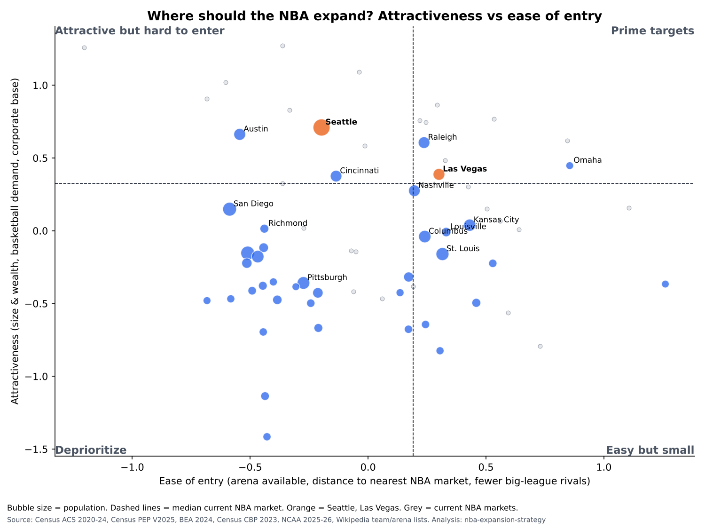

## Approach

Markets are placed on two separate axes, **attractiveness** and **ease of entry**, and the matrix splits them at the median current NBA market. Attractiveness has three pillars (A-C below). Every factor is converted to a z-score across the 66 complete U.S. markets; population, GDP and large-establishment counts are logged first. Factors are averaged with equal weights inside each pillar, and the three pillars are averaged with equal weights into the attractiveness score. Current NBA markets are scored the same way and serve as the benchmark. CBSA data are aggregated to markets: counts and populations are summed, income is population-weighted, and the 18-44 share is recomputed from counts.

1. **A. Market size and wealth:** population, median household income, share of residents aged 18-44, population growth 2020-25, and GDP.
2. **B. Basketball demand:** NCAA D-I men's home attendance per 1,000 residents, and WNBA presence. G League presence is shown but not scored, because G League teams are mostly NBA-owned affiliates.
3. **C. Corporate money:** establishments with 500+ employees, as a total and per 100k residents.
**Ease of entry** (separate axis, so nothing is double-counted) combines:
- an available arena (17,000+ seats without an NBA tenant);
- the log of straight-line miles to the nearest other NBA market, a proxy for cannibalizing existing teams' fans;
- NFL, MLB and NHL teams, counted as a negative.

**Robustness:** 10,000 random pillar weightings drawn from a Dirichlet(1,1,1) distribution (seed 42) give each market's probability of a top-5 or top-10 rank, its median rank and a 90% interval (`outputs/monte_carlo.csv`).

## Data & sources

| Factor | Source | Year |
|---|---|---|
| Population, households, income, age 18-44 | Census ACS 5-year summary file (www2.census.gov) | 2020-2024 |
| Population growth | Census Population Estimates, Vintage 2025 | 2020-2025 |
| GDP | BEA CAGDP1 county GDP summed to market | 2024 |
| Large establishments (500+ employees) | Census County Business Patterns (metro/micro file) | 2023 |
| NCAA D-I men's basketball home attendance | NCAA attendance records PDF | 2025-26 |
| NBA/NFL/MLB/NHL/MLS/WNBA/G League teams | Wikipedia league articles (current teams tables) | accessed 2026-11-05 |
| Arenas 17,000+ seats | Wikipedia: List of indoor arenas in the United States | accessed 2026-11-05 |
| Market definitions | Census CBSA/CSA delineation files | July 2023 |
| Team revenue by stream, central revenue share, national TV per team | Sportico team-finance reporting | 2025-26 |
| Mexico City, Vancouver, Toronto facts | Wikipedia (population, arena, history, coordinates) | accessed 2026-11-05 |
| Market locations | Census Gazetteer 2024 (CBSA internal points) | 2024 |
| Place of birth (transplant share) | Census ACS 5-year table B05002 | 2020-2024 |
| Expansion-team attendance (honeymoon) | Wikipedia season articles (game logs); ESPN NBA attendance (partial) | 1995-2026 |
| NBA arena coordinates, conferences | Wikipedia NBA current-teams table | accessed 2026-11-05 |
| Bidder landscape | ESPN (2026-10-02) | 2026 |
| Franchise value, team revenue; Las Vegas price | Sportico; ESPN (2026-10-02) | 2025-26 |
| Google Trends; NTTO overseas visitors | Skipped (see DEVIATIONS.md) | - |

**Coverage** (`outputs/coverage.csv`):

| factor | share_with_data | n_markets |
|---|---|---|
| population | 100% | 67 |
| median_hh_income | 100% | 67 |
| share_18_44 | 100% | 67 |
| households | 100% | 67 |
| pop_growth_2020_2025 | 100% | 67 |
| gdp_2024_usd | 97% | 67 |
| ncaa_d1_home_attendance | 100% | 67 |
| has_wnba | 100% | 67 |
| has_g_league | 100% | 67 |
| large_establishments_500plus | 99% | 67 |
| big4_other_leagues | 100% | 67 |
| arena_capable | 100% | 67 |
| google_trends_nba | 0% | 67 |
| overseas_visitors_ntto | 0% | 67 |

## Results

**Matrix quadrants, non-NBA markets** (`outputs/rankings.csv`):

| quadrant | short_name |
|---|---|
| Attractive but hard to enter | Seattle, Austin, Cincinnati |
| Deprioritize | San Diego, Richmond, Greenville, Tampa, Hartford, Jacksonville, Greensboro, Dayton, Pittsburgh, Harrisburg, Baton Rouge, Buffalo, Columbia, Virginia Beach, Tucson, Grand Rapids, Allentown, Albany, Fresno, Albuquerque, Rochester, Cape Coral, North Port |
| Easy but small | Nashville, Kansas City, Louisville, Columbus, St. Louis, Knoxville, Urban Honolulu, Birmingham, Tulsa, El Paso |
| Prime targets | Raleigh, Omaha, Las Vegas |

**Monte Carlo robustness**, top 15 by P(top 10):

| short_name | p_top5 | p_top10 | median_rank | rank_p05 | rank_p95 |
|---|---|---|---|---|---|
| Seattle | 98% | 100% | 2 | 1 | 5 |
| Las Vegas | 63% | 100% | 5 | 4 | 6 |
| Cincinnati | 48% | 97% | 6 | 2 | 8 |
| Raleigh | 75% | 94% | 3 | 1 | 12 |
| Austin | 76% | 92% | 2 | 1 | 14 |
| Omaha | 64% | 91% | 4 | 1 | 13 |
| Nashville | 38% | 87% | 6 | 3 | 15 |
| San Diego | 24% | 71% | 8 | 4 | 20 |
| Kansas City | 0% | 64% | 9 | 7 | 18 |
| Louisville | 0% | 40% | 12 | 8 | 19 |
| Richmond | 0% | 37% | 11 | 9 | 16 |
| Columbus | 0% | 35% | 12 | 7 | 22 |
| Knoxville | 10% | 30% | 18 | 4 | 30 |
| Dayton | 4% | 20% | 25 | 6 | 35 |
| Tampa | 0% | 12% | 15 | 10 | 32 |

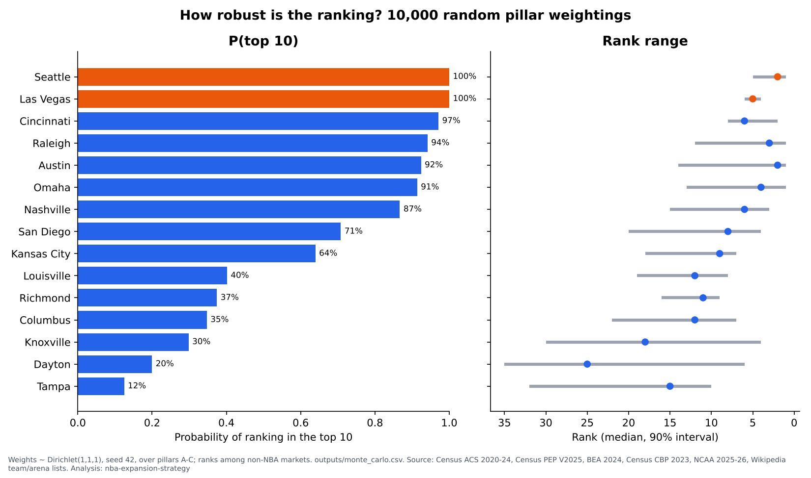

**Top 15 non-NBA markets** (equal weights; `outputs/rankings.csv`):

| rank_candidates | short_name | market_title | total_score | A_size_wealth | B_basketball_demand | C_corporate | ease_of_entry | quadrant | overlooked | top_pillar |
|---|---|---|---|---|---|---|---|---|---|---|
| 1 | Seattle | Seattle-Tacoma, WA | 0.71 | 1.06 | 0.61 | 0.45 | -0.20 | Attractive but hard to enter | True | A_size_wealth |
| 2 | Austin | Austin-Round Rock-San Marcos, TX | 0.66 | 1.31 | -0.23 | 0.91 | -0.54 | Attractive but hard to enter | True | A_size_wealth |
| 3 | Raleigh | Raleigh-Durham-Cary, NC | 0.61 | 0.61 | 1.37 | -0.16 | 0.24 | Prime targets | True | B_basketball_demand |
| 4 | Omaha | Omaha-Fremont, NE-IA | 0.45 | -0.34 | 1.13 | 0.55 | 0.86 | Prime targets | True | B_basketball_demand |
| 5 | Las Vegas | Las Vegas-Henderson, NV | 0.39 | 0.00 | 0.66 | 0.50 | 0.30 | Prime targets | True | B_basketball_demand |
| 6 | Cincinnati | Cincinnati-Wilmington, OH-KY-IN | 0.38 | -0.17 | 0.48 | 0.82 | -0.14 | Attractive but hard to enter | True | C_corporate |
| 7 | Nashville | Nashville-Davidson--Murfreesboro, TN | 0.27 | 0.38 | -0.09 | 0.53 | 0.20 | Easy but small | False | C_corporate |
| 8 | San Diego | San Diego-Chula Vista-Carlsbad, CA | 0.15 | 0.58 | -0.32 | 0.19 | -0.59 | Deprioritize | False | A_size_wealth |
| 9 | Kansas City | Kansas City-Overland Park-Kansas City, MO-KS | 0.04 | -0.03 | -0.16 | 0.30 | 0.43 | Easy but small | False | C_corporate |
| 10 | Richmond | Richmond, VA | 0.01 | -0.10 | 0.23 | -0.08 | -0.44 | Deprioritize | False | B_basketball_demand |
| 11 | Louisville | Louisville/Jefferson County--Elizabethtown, KY-IN | -0.01 | -0.55 | 0.41 | 0.11 | 0.33 | Easy but small | False | B_basketball_demand |
| 12 | Columbus | Columbus-Marion-Zanesville, OH | -0.04 | 0.08 | -0.34 | 0.14 | 0.24 | Easy but small | False | C_corporate |
| 13 | Greenville | Greenville-Spartanburg-Anderson, SC | -0.12 | -0.33 | -0.03 | 0.01 | -0.44 | Deprioritize | False | C_corporate |
| 14 | Tampa | Tampa-St. Petersburg-Clearwater, FL | -0.15 | -0.00 | -0.67 | 0.21 | -0.51 | Deprioritize | False | C_corporate |
| 15 | St. Louis | St. Louis-St. Charles-Farmington, MO-IL | -0.16 | -0.29 | -0.42 | 0.24 | 0.32 | Easy but small | False | C_corporate |

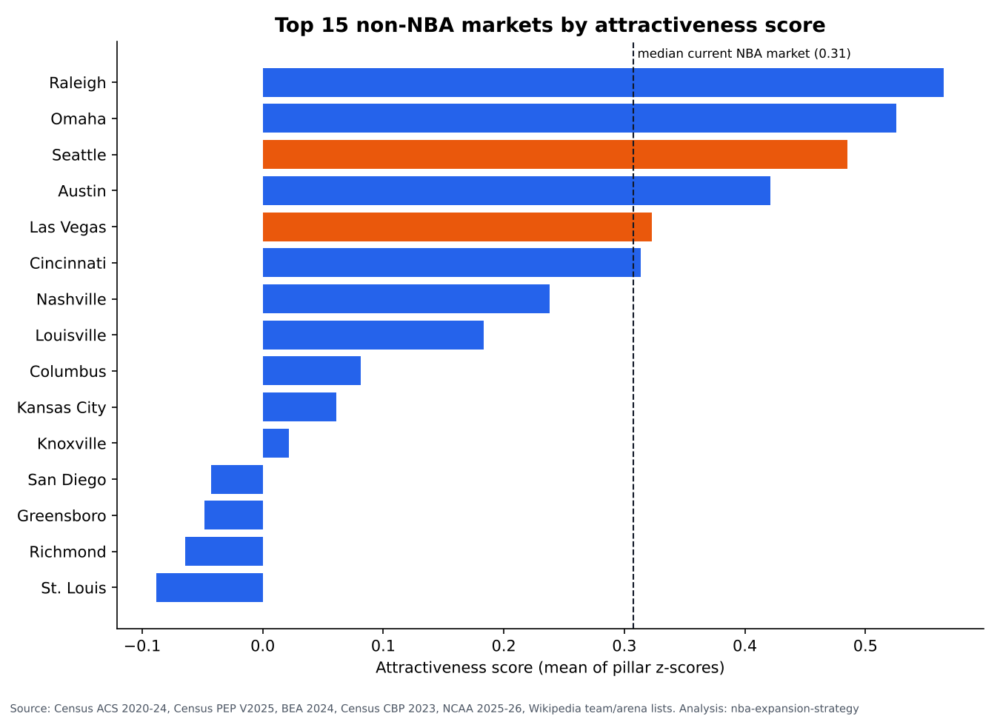

**How the top 10 changed from v1.** v1 ranked CBSAs and scored G League presence. The middle column shows the switch to CSAs with G League still scored. The final-rank column is the current v3 model, which also moves competition and arena onto the ease-of-entry axis (`outputs/top10_change.csv`). Omaha was below 1M people as a CBSA, so it was not in the v1 study set.

| short_name | market_title | rank_final_csa_no_gleague | top_pillar | rank_v1_cbsa_with_gleague | rank_csa_with_gleague |
|---|---|---|---|---|---|
| Seattle | Seattle-Tacoma, WA | #1 | A_size_wealth | #3 | #2 |
| Austin | Austin-Round Rock-San Marcos, TX | #2 | A_size_wealth | #2 | #1 |
| Raleigh | Raleigh-Durham-Cary, NC | #3 | B_basketball_demand | #9 | #3 |
| Omaha | Omaha-Fremont, NE-IA | #4 | B_basketball_demand |  | #6 |
| Las Vegas | Las Vegas-Henderson, NV | #5 | B_basketball_demand | #7 | #7 |
| Cincinnati | Cincinnati-Wilmington, OH-KY-IN | #6 | C_corporate | #5 | #5 |
| Nashville | Nashville-Davidson--Murfreesboro, TN | #7 | C_corporate | #4 | #8 |
| San Diego | San Diego-Chula Vista-Carlsbad, CA | #8 | A_size_wealth | #10 | #4 |
| Kansas City | Kansas City-Overland Park-Kansas City, MO-KS | #9 | C_corporate | #11 | #9 |
| Richmond | Richmond, VA | #10 | B_basketball_demand | #14 | #11 |
| Louisville | Louisville/Jefferson County--Elizabethtown, KY-IN | #11 | B_basketball_demand | #8 | #12 |
| Columbus | Columbus-Marion-Zanesville, OH | #12 | C_corporate | #6 | #10 |
| San Jose | merged into a larger CSA (see metros.csv member_metros) |  |  | #1 |  |

**Does the scorecard recognize existing NBA markets?** Difference in means, NBA minus non-NBA, with Welch 95% CI (`outputs/validity.csv`). This is an association check, not a prediction:

| measure | mean_nba | mean_non_nba | diff_nba_minus_non | ci95_low | ci95_high | point_biserial_r | p_value |
|---|---|---|---|---|---|---|---|
| A_size_wealth | 0.43 | -0.30 | 0.73 | 0.44 | 1.02 | 0.54 | 0.00 |
| B_basketball_demand | 0.05 | -0.03 | 0.08 | -0.22 | 0.38 | 0.07 | 0.60 |
| C_corporate | 0.56 | -0.39 | 0.95 | 0.55 | 1.35 | 0.51 | 0.00 |
| total_score | 0.35 | -0.24 | 0.59 | 0.31 | 0.86 | 0.49 | 0.00 |

**Sensitivity:** rank under six weightings (`outputs/sensitivity.csv`). A blank in the arena column means the market is not arena-ready.

| short_name | rank_equal | rank_size_heavy | rank_wealth_corporate_heavy | rank_demand_heavy | rank_no_college | rank_arena_required | top10_frequency |
|---|---|---|---|---|---|---|---|
| Seattle | 1 | 2 | 2 | 2 | 1 | 1 | 6 |
| Austin | 2 | 1 | 1 | 5 | 3 |  | 5 |
| Raleigh | 3 | 3 | 6 | 1 | 7 | 2 | 6 |
| Omaha | 4 | 7 | 4 | 3 | 10 | 3 | 6 |
| Las Vegas | 5 | 5 | 5 | 4 | 2 | 4 | 6 |
| Cincinnati | 6 | 8 | 3 | 6 | 6 | 5 | 6 |
| Nashville | 7 | 4 | 7 | 7 | 4 | 6 | 6 |
| San Diego | 8 | 6 | 8 | 11 | 5 |  | 4 |
| Kansas City | 9 | 9 | 9 | 12 | 8 | 7 | 5 |
| Richmond | 10 | 11 | 12 | 10 | 14 |  | 2 |
| Louisville | 11 | 14 | 10 | 8 | 18 | 8 | 3 |
| Columbus | 12 | 10 | 11 | 15 | 9 | 9 | 3 |
| Greenville | 13 | 16 | 15 | 14 | 15 |  | 0 |
| Tampa | 14 | 12 | 14 | 22 | 11 | 10 | 1 |
| St. Louis | 15 | 17 | 13 | 21 | 13 | 11 | 0 |

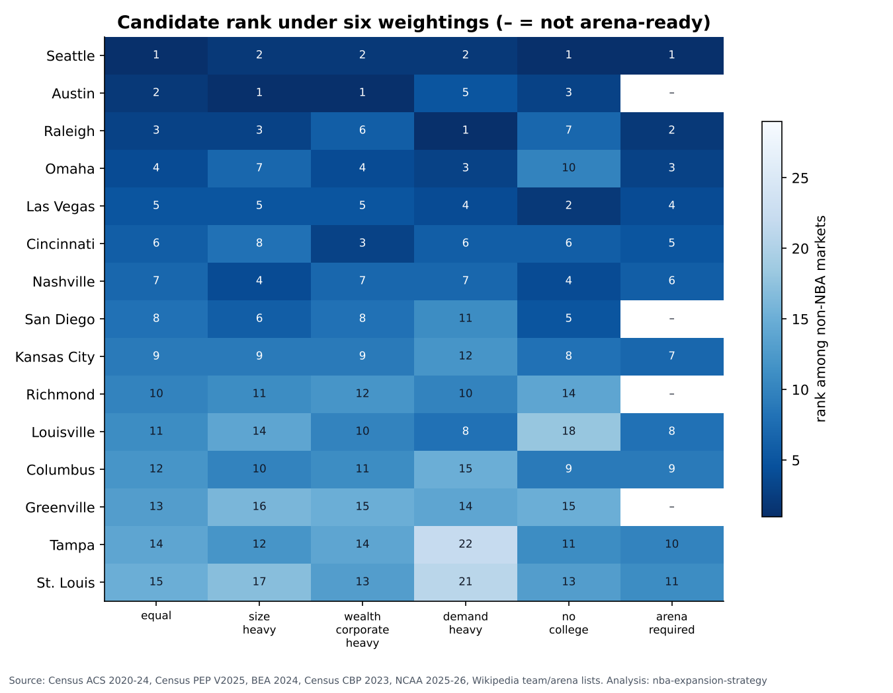
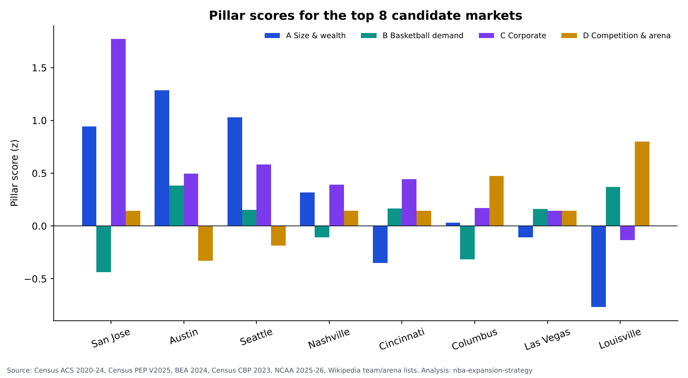
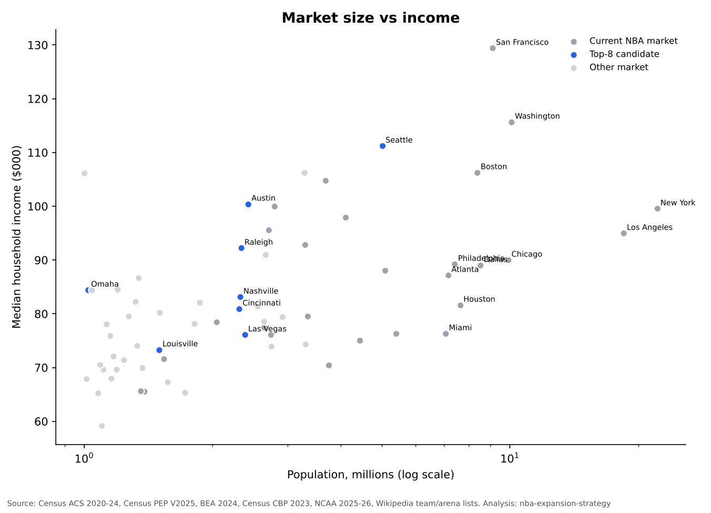

## International options: Mexico City & San Juan (partial data)

These markets are scored **only on the factors that have a comparable source**, standardized against the U.S. markets. Each pillar averages the factors it has, and the total averages the pillars it has. They sit outside the U.S. rankings and the Monte Carlo; "would rank" shows where the score would fall (`outputs/partial_markets.csv`). Sources and conversions are in `data/manual/international_markets.csv` and DEVIATIONS.md.

| short_name | market_type | total_score | A_size_wealth | B_basketball_demand | C_corporate | ease_of_entry | quadrant | rank_if_included | miles_to_nearest_nba | factors_used |
|---|---|---|---|---|---|---|---|---|---|---|
| San Juan (partial data) | CSA | -1.19 | -1.57 | -0.80 | no data | 1.54 | Easy but small | 39 | 1,068.62 | population, median_hh_income, share_18_44, pop_growth_2020_2025, ncaa_att_per_1k, has_wnba, arena_available, miles_to_nearest_nba, big4_other_leagues |
| Mexico City (partial data) | International | 0.61 | 1.74 | -0.52 | no data | 1.30 | Prime targets | 3 | 691.73 | population, gdp_2024_usd, has_wnba, arena_available, miles_to_nearest_nba, big4_other_leagues |

## Fan behavior & market risk

These are behavioral indicators. They are reported, not scored (`outputs/fan_behavior.csv`, `outputs/college_vs_pro.csv`).

- **Transplant share** is the share of residents born outside their current state. Transplants often keep loyalty to the teams they grew up with, so this is a divided-loyalty risk; its sign is ambiguous.
- **College vs pro:** across the 27 NBA markets, the correlation between college attendance per capita and the attractiveness score without college is r = -0.20 (p = 0.31). With college attendance removed, 9 of the top 10 stay. Dropped: Richmond. Added: Columbus.
- **Honeymoon curve:** average home attendance indexed to the first season, from Wikipedia season game logs (`data/manual/expansion_attendance_wiki.csv`). Three teams: Golden Knights, Kraken and Raptors. The Raptors changed arenas mid-1998-99 (SkyDome to Air Canada Centre), so their curve mixes novelty and venue effects. **Sellout cap:** attendance can't exceed capacity. The flat Golden Knights and Kraken lines (index ≈ 100) show sold-out arenas, not evidence that demand stayed flat; any demand above capacity is invisible here.

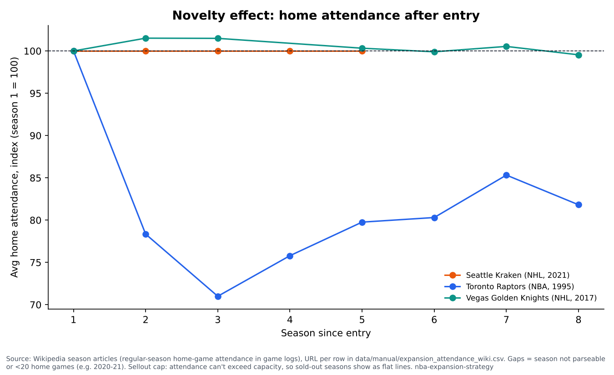

| short_name | transplant_share | transplant_share_vs_nba_median | ncaa_att_per_1k | rank_equal | rank_no_college |
|---|---|---|---|---|---|
| Seattle | 56% | +11% | 29.2 | 1.0 | 1.0 |
| Austin | 49% | +5% | 88.3 | 2.0 | 3.0 |
| Raleigh | 54% | +9% | 336.9 | 3.0 | 7.0 |
| Omaha | 41% | -3% | 300.6 | 4.0 | 10.0 |
| Las Vegas | 74% | +30% | 36.7 | 5.0 | 2.0 |
| Cincinnati | 33% | -11% | 199.9 | 6.0 | 6.0 |
| Nashville | 49% | +4% | 110.6 | 7.0 | 4.0 |
| San Diego | 49% | +4% | 74.3 | 8.0 | 5.0 |
| Kansas City | 45% | +1% | 99.7 | 9.0 | 8.0 |
| Richmond | 41% | -3% | 159.9 | 10.0 | 14.0 |
| Louisville | 37% | -8% | 188.1 | 11.0 | 18.0 |
| Columbus | 29% | -16% | 72.4 | 12.0 | 9.0 |

## Operations: realignment

Adding Seattle and Las Vegas to the West means one Western team must move East for 16-16 conferences. The proxy assumes each team makes one round trip to every conference opponent, in straight-line miles. It ignores real schedules, inter-conference games, chained road trips and back-to-backs (`outputs/realignment_travel.csv`).

| option | teams_east | teams_west | avg_miles_per_team | east_avg_per_team | west_avg_per_team | moved_team | moved_team_miles | moved_team_miles_if_stayed_west |
|---|---|---|---|---|---|---|---|---|
| Current 30 teams | 15 | 15 | 21,680 | 16,147 | 27,214 |  |  |  |
| 32 teams: Grizzlies move East | 16 | 16 | 23,219 | 17,786 | 28,651 | Memphis Grizzlies | 21,189 | 36,475 |
| 32 teams: Timberwolves move East | 16 | 16 | 23,438 | 18,330 | 28,546 | Minnesota Timberwolves | 25,543 | 37,318 |
| 32 teams: Pelicans move East | 16 | 16 | 23,376 | 18,505 | 28,246 | New Orleans Pelicans | 26,939 | 39,715 |
| 32 teams: Thunder move East | 16 | 16 | 24,379 | 19,041 | 29,717 | Oklahoma City Thunder | 31,227 | 27,948 |

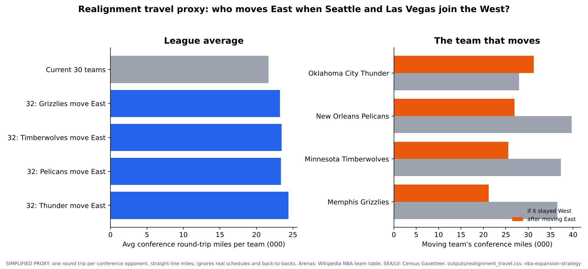

## Seattle vs Las Vegas

See the full side-by-side in [`memo/HEAD_TO_HEAD.md`](memo/HEAD_TO_HEAD.md) and the reported bidding groups in [`research/bidder_landscape.csv`](research/bidder_landscape.csv).

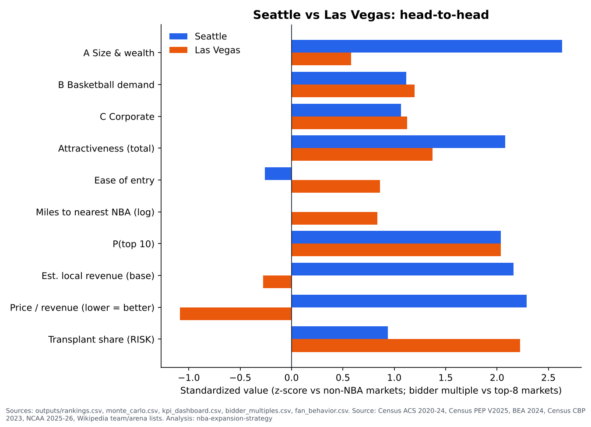

## Focus markets

These are the reported front-runners (Seattle, Las Vegas), Mexico City, and markets often named in coverage (`outputs/focus_markets.csv`, `research/focus_markets.md`).

| focus_label | scored | attractiveness_rank | total_score | arena_ready | population |
|---|---|---|---|---|---|
| Seattle | Y | #1 | 0.71 | Y | 5.0M |
| Las Vegas | Y | #5 | 0.39 | Y | 2.4M |
| Pittsburgh | Y | #21 | -0.36 | Y | 2.7M |
| Louisville | Y | #11 | -0.01 | Y | 1.5M |
| Kansas City | Y | #9 | 0.04 | Y | 2.6M |
| Nashville | Y | #7 | 0.27 | Y | 2.3M |
| Austin | Y | #2 | 0.66 | N | 2.4M |
| San Diego | Y | #8 | 0.15 | N | 3.3M |
| St. Louis | Y | #15 | -0.16 | Y | 2.9M |
| Columbus, OH | Y | #12 | -0.04 | Y | 2.6M |
| Cincinnati | Y | #6 | 0.38 | Y | 2.3M |
| Raleigh | Y | #3 | 0.61 | Y | 2.3M |
| Tampa | Y | #14 | -0.15 | Y | 3.3M |
| Baltimore | Y | (existing NBA market) | 1.02 | N | 10.1M |
| Omaha | Y | #4 | 0.45 | Y | 1.0M |
| Mexico City | N (outside U.S. data) |  |  |  | 21.4M |
| Vancouver | N (outside U.S. data) |  |  |  | 2.6M |

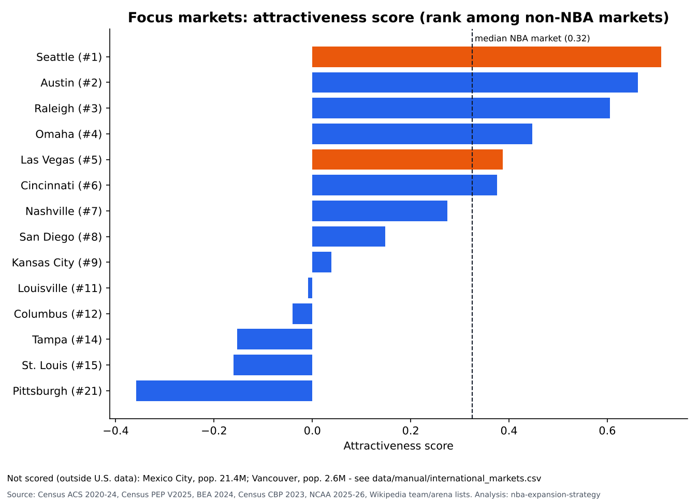

## Business case

Local revenue starts from the average NBA team's reported revenue by stream (Sportico, 2025-26). Each stream is scaled by how the market compares with the median NBA market, using a labeled elasticity assumption. Min and max are taken across the elasticity scenarios.

| short_name | attractiveness_rank | top10_frequency | population | median_hh_income | competing_teams | arena_ready | est_local_revenue_low | est_local_revenue_base | est_local_revenue_high | local_revenue_per_capita_base |
|---|---|---|---|---|---|---|---|---|---|---|
| Seattle | 1.00 | 6 | 5.01M | 111,229.39 | 3 | Y | $290.2M | $307.7M | $326.7M | 61.42 |
| Austin | 2.00 | 5 | 2.43M | 100,431.00 | 0 | N | $182.8M | $208.6M | $238.2M | 85.97 |
| Raleigh | 3.00 | 6 | 2.34M | 92,233.42 | 1 | Y | $178.1M | $205.9M | $238.2M | 88.14 |
| Omaha | 4.00 | 6 | 1.02M | 84,444.28 | 0 | Y | $97.7M | $138.0M | $194.9M | 135.38 |
| Las Vegas | 5.00 | 6 | 2.38M | 76,112.78 | 2 | Y | $169.6M | $198.9M | $233.5M | 83.44 |
| Cincinnati | 6.00 | 6 | 2.31M | 80,925.39 | 2 | Y | $170.4M | $199.5M | $233.7M | 86.26 |
| Nashville | 7.00 | 6 | 2.32M | 83,136.24 | 2 | Y | $164.0M | $194.2M | $230.0M | 83.58 |
| San Diego | 8.00 | 4 | 3.29M | 106,268.00 | 1 | N | $222.0M | $237.2M | $253.8M | 72.11 |

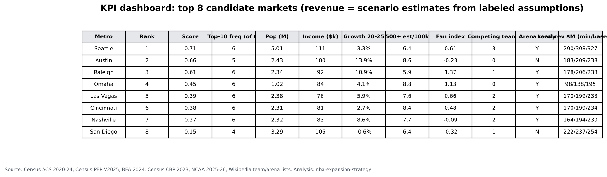
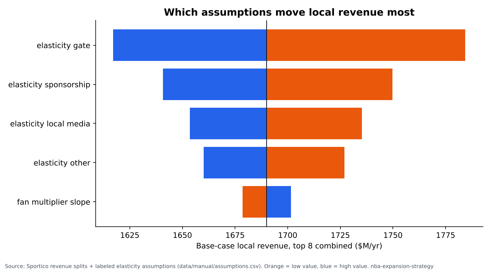

**Owner economics: fee share minus 20-year NPV of dilution** (base fee, all central revenue, gross; `outputs/owner_npv.csv`):

| growth / discount | 6% | 8% | 10% |
|---|---|---|---|
| 0% | $432.4M | $451.8M | $467.0M |
| 3% | $380.5M | $410.0M | $433.0M |
| 6% | $303.7M | $349.3M | $384.3M |

Range of fee share minus NPV by pool definition and owner share (all growth, discount and fee scenarios):

| pool_definition | owner_share | min | max |
|---|---|---|---|
| all_central_revenue | gross | $203.7M | $567.0M |
| all_central_revenue | net_of_player_share | $337.8M | $617.8M |
| national_tv_only | gross | $264.4M | $590.0M |
| national_tv_only | net_of_player_share | $367.6M | $629.1M |

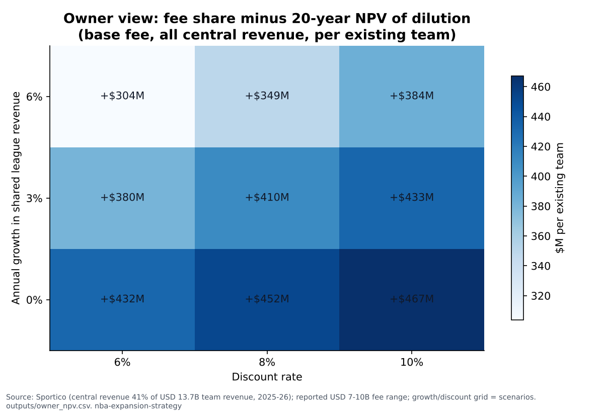

**Bidder view: price / estimated revenue vs league average** (`outputs/bidder_multiples.csv`). Revenue = estimated local revenue + 1/32 of central revenue:

Price types differ: Las Vegas is a reported expected sale price, Seattle a valuation estimate, the rest an assumed fee. They are not strictly comparable (see `price_type`).

| short_name | price_type | price_to_revenue_base | price_to_revenue_range | league_avg_value_to_revenue | premium_vs_league_avg_multiple |
|---|---|---|---|---|---|
| Seattle | reported valuation estimate (not a bid) | 12.4 | 11.9x-12.9x | 14.6 | -15% |
| San Diego | assumed fee | 20.6 | 19.8x-21.4x | 14.6 | +41% |
| Austin | assumed fee | 22.1 | 20.5x-23.7x | 14.6 | +52% |
| Raleigh | assumed fee | 22.3 | 20.5x-24.0x | 14.6 | +53% |
| Cincinnati | assumed fee | 22.7 | 20.8x-24.6x | 14.6 | +56% |
| Nashville | assumed fee | 23.0 | 21.0x-25.0x | 14.6 | +58% |
| Las Vegas | reported expected sale price (bid) | 26.7 | 24.5x-29.0x | 14.6 | +83% |
| Omaha | assumed fee | 27.1 | 22.9x-31.1x | 14.6 | +86% |

## Market & competitive research

- `research/trends.csv`: dated, sourced facts on the expansion process (including ESPN's 2026-10-02 report that the league is more focused on Las Vegas), fees, the media deal, team revenue, and NHL, WNBA and MLS expansions.
- `research/comparables.md`: Vegas Golden Knights, Seattle Kraken, and recent WNBA expansion teams.
- `research/focus_markets.md`: Seattle, Las Vegas, Mexico City, Vancouver and the markets to watch.
- `research/competitive_landscape.csv`: pro teams, D-I schools and arenas in each top-8 and focus market.
- `research/insights.csv`: themes with linked evidence; implications left for Noah.

## Recommendation

*(Written by Noah.)*

## Limitations & data I'd buy

- **Associations only.** The validity check asks whether the scorecard separates existing NBA markets from the rest. It does not show what causes team success.
- **College basketball per capita can dominate a small market.** Omaha and Raleigh-Durham rank high mostly on Pillar B. See `top_pillar` in `outputs/rankings.csv` and the no-college check above.
- **Distance is a rough proxy for cannibalization.** Ease of entry uses straight-line miles from one point per market, not drive times or TV overlap. Existing teams' fans in a market (e.g. Suns or Lakers fans in Las Vegas) are not measured.
- **Transplant share is inflated where a market crosses state lines** (people born in the neighboring state count as transplants), and it is not scored.
- **Monte Carlo varies only the pillar weights**, not the factor choice or the data.
- **Bidder multiples mix price types that are not strictly comparable.** Las Vegas uses ESPN's reported expected sale price (~$10B, from three competing bids). Seattle uses a sources' valuation estimate (~$6B, with no competing bid yet). Other markets use the $8.5B assumed base fee. Arena costs (except the Las Vegas column) and timing are ignored.
- **Missing data:** Google Trends (folder empty) and NTTO overseas visitors (dashboard only) are not in the scorecard. Mexico City and Vancouver are not scored. Virginia Beach GDP is missing.
- **NCAA mapping:** schools are assigned to markets by main-campus county. Only D-I schools in the study markets are mapped.
- **Business case:** each stream is scaled with an elasticity calibrated on one pair of teams. Dilution assumes expansion teams add no new shared revenue (the media deal is fixed through 2035-36), and years beyond the deal assume renewal.
- **Data I'd buy:** Nielsen TV ratings and DMA viewing households, team-level revenues, ticket prices, sponsorship deals, NBA League Pass and merchandise data.

## Reproduce

```bash
pip install -r requirements.txt
python run_all.py
```

## Tools

Built in Python with the help of Claude Code (AI coding assistant). Research design, assumptions review, interpretation and recommendations are my own.

Libraries: pandas, numpy, statsmodels, scipy, matplotlib, requests, pytest, openpyxl, pdfplumber, lxml. Every number in this README is generated by `src/report.py`; my working rules are in [`PROJECT_RULES.md`](PROJECT_RULES.md).
