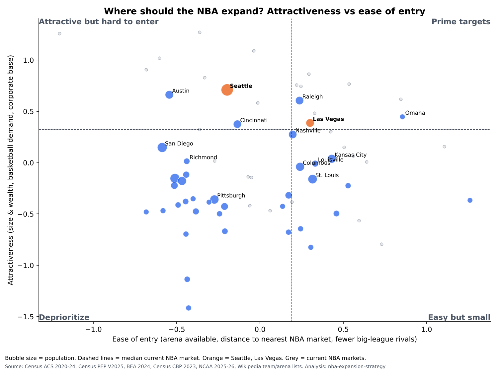

# Executive summary

*Template. Headline and recommendation written by Noah. Numbers generated by `src/report.py`.*

## Headline

## Key numbers

1. **Seattle / Las Vegas:** rank #1 / #5 among 39 non-NBA markets. Chance of a top-10 rank across 10,000 random weightings: 100% / 100%.
2. **Prime targets** (above the NBA median on both attractiveness and ease of entry): 3, namely Raleigh, Omaha, Las Vegas.
3. **Owner economics:** fee share $566.7M per existing team vs a 20-year NPV of dilution of $156.6M (3% growth, 8% discount). Shared revenue would need to grow 14% a year before dilution outweighs the fee.
4. **Bidder view:** Las Vegas at the reported ~$10B is 26.7x estimated revenue, and Seattle at the reported ~$6B valuation is 12.4x, vs a league-average value/revenue of 14.6x.

## Top 5 by probability of a top-10 rank

| Market | Rank (equal weights) | P(top 10) | Ease of entry | Quadrant | Est. local revenue (base) | Transplant share |
|---|---|---|---|---|---|---|
| Seattle | 1 | 100% | -0.20 | Attractive but hard to enter | $307.7M | 56% |
| Las Vegas | 5 | 100% | 0.30 | Prime targets | $198.9M | 74% |
| Cincinnati | 6 | 97% | -0.14 | Attractive but hard to enter | $199.5M | 33% |
| Raleigh | 3 | 94% | 0.24 | Prime targets | $205.9M | 54% |
| Austin | 2 | 92% | -0.54 | Attractive but hard to enter | $208.6M | 49% |

## Recommendation
