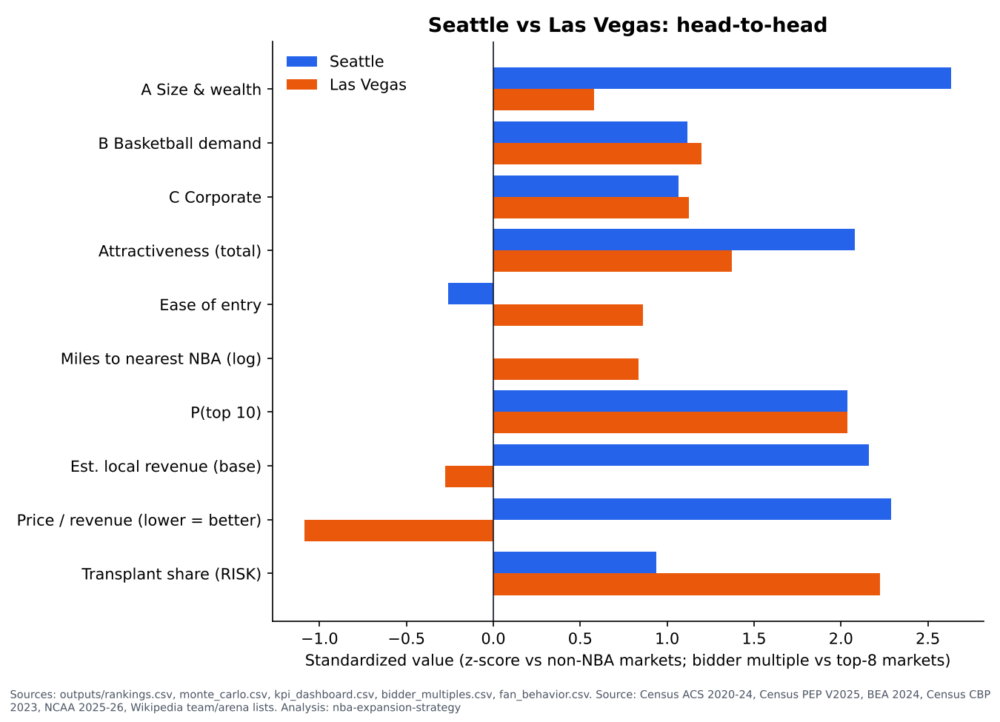

# Seattle vs Las Vegas (and Mexico City): head-to-head

*Generated by `src/report.py` from `outputs/`. Interpretation by Noah. Mexico City has partial data: it is scored only on comparable factors and is not in the rankings or Monte Carlo.*

| Metric | Seattle | Las Vegas | Mexico City | Source |
|---|---|---|---|---|
| Market | Seattle-Tacoma, WA | Las Vegas-Henderson, NV | Greater Mexico City (Mexico) | data/processed/metros.csv |
| Population | 5.01M | 2.38M | 21.44M (2020) | metros.csv; international_markets.csv |
| Attractiveness rank (of non-NBA markets) | #1 | #5 | would rank #3 (partial data) | outputs/rankings.csv; partial_markets.csv |
| Attractiveness score | 0.71 | 0.39 | 0.61 (partial: A and B subsets only) | outputs/rankings.csv; partial_markets.csv |
| Pillar A: size & wealth | 1.06 | 0.00 | 1.74 (partial) | outputs/rankings.csv; partial_markets.csv |
| Pillar B: basketball demand | 0.61 | 0.66 | -0.52 (partial) | outputs/rankings.csv; partial_markets.csv |
| Pillar C: corporate | 0.45 | 0.50 | not available (partial data) | outputs/rankings.csv |
| P(top 10) / P(top 5) | 100% / 98% | 100% / 63% | not in Monte Carlo (partial data) | outputs/monte_carlo.csv |
| Median rank (90% interval) | #2 (#1-#5) | #5 (#4-#6) | not in Monte Carlo (partial data) | outputs/monte_carlo.csv |
| Ease of entry / quadrant | -0.20 / Attractive but hard to enter | 0.30 / Prime targets | 1.30 / Prime targets | outputs/rankings.csv; partial_markets.csv |
| Miles to nearest NBA market | 134 | 231 | 692 | outputs/rankings.csv; partial_markets.csv |
| NBA markets within 200 miles | 1 | 0 | 0 | outputs/rankings.csv; partial_markets.csv |
| Big-league rivals (NFL+MLB+NHL) | 3 | 2 | 0 (Liga MX soccer not counted) | data/processed/metros.csv; international_markets.csv |
| Arenas 17,000+ seats without NBA tenant (capacity; tenants) | Y: Tacoma Dome (20,722; no major tenant listed); Climate Pledge Arena (18,500; Seattle Kraken (NHL) Seattle Storm (WNBA) Seattle Torrent (PWHL) Seattle Redhawks (NCAA)) | Y: T-Mobile Arena (18,800; Vegas Golden Knights (NHL)); Thomas & Mack Center (18,500; UNLV Runnin' Rebels) | Y: Arena CDMX (22,300; Mexico City Capitanes, G League) | data/manual/arenas.csv; international_markets.csv |
| G League team | N | N | Y: Mexico City Capitanes | data/manual/teams.csv; international_markets.csv |
| Demonstrated demand since 2011-12 (not scored) | 4 events (4 NBA games; NBA preseason) | 22 events (22 NBA games; NBA Cup final; NBA Cup knockout (semifinal); NBA Summer League (Las Vegas) championship) | 16 events (15 NBA games; G League team; NBA preseason; NBA regular season (neutral site)) | outputs/demand_summary.csv |
| Transplant share (divided-loyalty risk) | 56% (+11% vs NBA median) | 74% (+30% vs NBA median) | not available (partial data) | outputs/fan_behavior.csv |
| Est. local revenue min / base / max | $290.2M / $307.7M / $326.7M | $169.6M / $198.9M / $233.5M | not available (partial data) | outputs/kpi_dashboard.csv |
| Price used (type; not strictly comparable) | $6.00B: reported valuation estimate (not a bid) | $10.00B: reported expected sale price (bid) | not reported | outputs/bidder_multiples.csv |
| Price / est. revenue (league avg value/revenue) | 12.4x (14.6x) | 26.7x (14.6x) | not available (partial data) | outputs/bidder_multiples.csv |
| Reported bidders | Samantha Holloway (Kraken owner) group, incl. Melinda French Gates and Andy Jassy; BlackSun Private Equity with the Tulalip Tribes; At least one unidentified group (per industry sources) | Nancy Walton Laurie and Bill Laurie (Laurie lives in Henderson, NV); Steve Apostolopoulos and Marc Lasry (group based in Toronto; Lasry former Bucks owner); Bill Foley and Jerry Colangelo (Foley owns the NHL Golden Knights) | A Mexico City-based group (reported) that approached PJT Partners | research/bidder_landscape.csv |
| Owner NPV: fee share − 20y dilution (league-wide, per existing team) | $410.0M (both markets together; 3% growth, 8% discount) | $410.0M (both markets together; 3% growth, 8% discount) | not available (partial data) | outputs/owner_npv.csv |

Reported league focus: ESPN (2026-10-02) says the NBA and PJT Partners are more focused on Las Vegas, where bidding is more robust (`research/trends.csv`).

## So what
